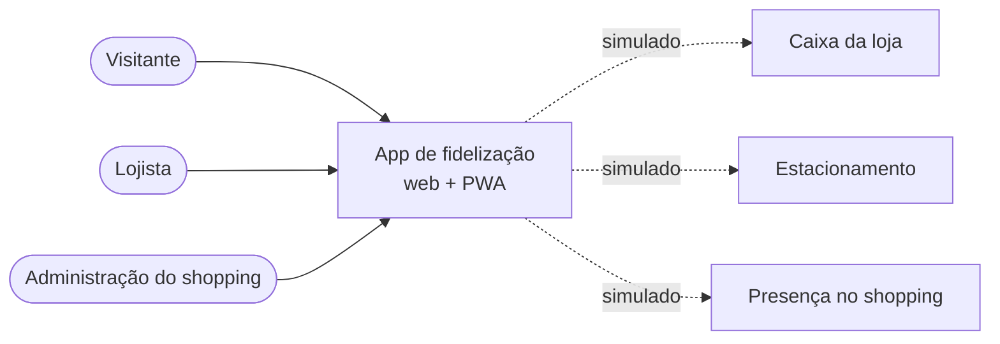
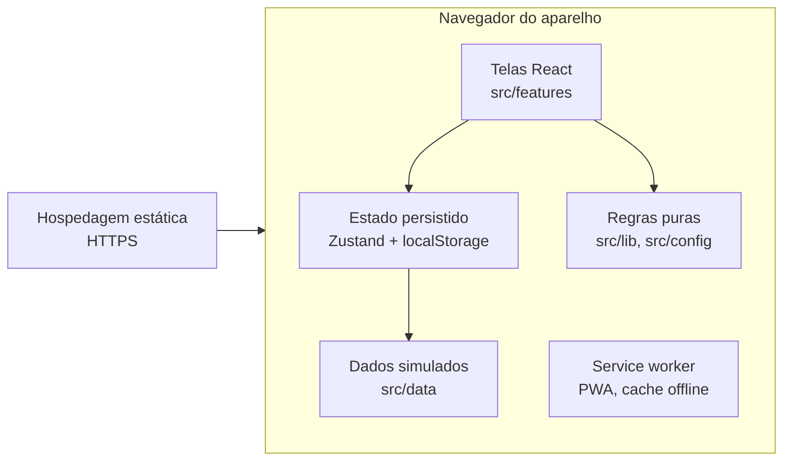

# Documento de design de software (SDD)

[README](../README.md) · [PRD](prd.md)

Como o MVP é construído. O **que** e o **porquê** estão no [PRD](prd.md); as decisões técnicas ficam na seção 8. Este documento precisa refletir o código entregue e define as convenções de código que todos seguem (seção 9).

> **Status:** stack e convenções definidas no épico E4. Itens marcados com ⏳ ainda dependem de decisão.

## 1. Escopo técnico

Implementa os requisitos **Must** do [PRD](prd.md#5-requisitos-funcionais): campanhas recorrentes (F06), ofertas relâmpago (F16), registro de compra (F01), pontos (F02), troca por desconto (F03) e por estacionamento (F23), indicação (F27), conta (F04) e os requisitos não funcionais RNF01 a RNF06.

## 2. Arquitetura

Uma aplicação web estática, sem backend: roda inteira no navegador e guarda os dados no próprio aparelho. Quem a abre num computador vê o layout web; em tablet ou celular, vê o layout de aplicativo e pode instalá-la como PWA.

**Contexto:**



**Contêineres:**



- **Acesso:** o app abre sem login; ver campanhas e ofertas não exige conta. Resgatar, pontuar e indicar pedem para entrar, escolhendo um usuário de exemplo, sem senha (visitante, lojista ou administração do shopping), em qualquer tamanho de tela.
- **Dados por navegador:** os dados ficam no localStorage e são compartilhados entre as abas e janelas do mesmo navegador, que se atualizam juntas. A sessão (usuário logado) fica no sessionStorage, uma por aba. Assim, no mesmo computador, uma janela no painel do shopping e outra no app do visitante mostram a mesma campanha ao vivo. Aparelhos diferentes não compartilham dados.
- **Layout por largura:** abaixo de 1024 px (tablet e celular), layout de aplicativo com a navegação do app do shopping (atalhos e seta de voltar) e "Instalar app" opcional no perfil; a partir de 1024 px, layout web. Telas, jornadas e tema no [design](design.md).

## 3. Stack

| Camada | Escolha |
|---|---|
| Linguagem e base | TypeScript (strict), React, Vite |
| Rotas | React Router |
| Estilo | Tailwind CSS |
| Estado e persistência | Zustand com `persist` (localStorage), sincronizado entre abas |
| PWA | `vite-plugin-pwa` (manifest, ícones e service worker) |
| Ícones | `lucide-react` |
| Testes | Vitest, para as regras puras |
| Qualidade | ESLint e Prettier |
| Publicação | ⏳ Hospedagem estática com HTTPS, necessária para instalar o PWA (seção 7) |

Versões no `package.json`. Motivos e alternativas na seção 8.

## 4. Módulos

Cada módulo é uma pasta em `src/features/`, com suas telas, componentes, estado e regras.

| Módulo | Pasta | Requisitos | Responsabilidade |
|---|---|---|---|
| Conta | `account` | F04 | Login simulado, sessão, troca de usuário e restauração dos dados de demonstração |
| Campanhas e ofertas | `offers` | F06, F16 | Visitante: campanhas, ofertas, lotes, contagem regressiva, resgate de cupom com limite real. Lojista: criar e acompanhar oferta relâmpago |
| Compras e pontos | `points` | F01, F02, F03, F23 | Visitante: gerar código de compra, saldo, extrato, troca por cupom de desconto ou de estacionamento, "Meus cupons". Lojista: confirmar compra com código e valor |
| Indicação | `referral` | F27 | Código do usuário, cadastro com código e bônus para os dois lados |
| Administração do shopping | `mall` | F06 | Painel das campanhas, liberação de lote na hora e resultados agregados, sem dados pessoais (RNF05). Criar campanha pela tela fica fora do MVP: campanhas vêm dos dados simulados |

## 5. Modelo de dados

Interfaces em `src/types/`. Valores em centavos (inteiros); datas em texto ISO 8601; ids em texto.

| Entidade | Interface | Campos principais |
|---|---|---|
| Usuário | `User` | `id`, `name`, `role` (`visitor`, `merchant` ou `mall`), `storeId` (lojista), `referralCode`, `referredBy` |
| Loja | `Store` | `id`, `name`, `category` |
| Campanha | `Campaign` | `id`, `name`, `date`, `storeIds`, `description` |
| Oferta | `Offer` | `id`, `storeId`, `campaignId` (vazio na oferta relâmpago), `title`, `discountPercent`, `batches` (`releaseAt`, `quantity`), `endsAt`, `redeemedCount` |
| Recompensa | `Reward` | `id`, `title`, `kind` (`discount` ou `parking`), `pointsCost`, `limit` |
| Cupom | `Coupon` | `id`, `userId`, `source` (oferta ou recompensa), `sourceId`, `code`, `status`, `createdAt` |
| Código de compra | `PurchaseCode` | `code` (6 dígitos), `userId`, `expiresAt`, `usedAt` |
| Compra | `Purchase` | `id`, `userId`, `storeId`, `purchaseCode`, `amountCents`, `createdAt` |
| Movimento de pontos | `PointsEntry` | `id`, `userId`, `points` (positivo ou negativo), `reason` (`purchase`, `redemption`, `referral`), `refId`, `createdAt` |
| Indicação | `Referral` | `id`, `referrerId`, `referredId`, `status` (`pending` ou `rewarded`) |

- O saldo é a soma dos movimentos de pontos; não é guardado à parte.
- O resgate previsto no PRD é o par cupom + movimento negativo de pontos.
- A liberação de lote na hora acrescenta um lote com `releaseAt` igual ao momento do clique.
- Validade e reserva do cupom dependem da Q10 do PRD.

**Comprovação de compra (D12 do PRD):** no caixa, o visitante gera no app um código de 6 dígitos, de uso único e com validade curta, e o informa ao lojista, como no código de entrega do iFood. O lojista digita o código e o valor no seu perfil; a compra fica registrada na loja dele e os pontos caem na conta do visitante. Código vencido, já usado ou inexistente é recusado.

## 6. Real × simulado

Exigência do RNF03: tudo o que for simulado aparece como simulação na interface e aqui.

| Componente | Real ou simulado | Como |
|---|---|---|
| Login e conta | Simulado | Usuários de exemplo, sem senha |
| Lojas, campanhas, ofertas e recompensas iniciais | Simulado | `src/data/`, com nomes fictícios |
| Prazos, lotes, contagem e quantidade restante | Real | Relógio do aparelho; a oferta encerra ao expirar ou esgotar (RNF04) |
| Código de compra | Real | Uso único, validade e recusa de código inválido; o lojista confirma o valor |
| Integração com o caixa da loja | Simulado | O lojista digita o valor; não há ligação com o sistema de vendas |
| Pontos, saldo, cupons e indicação | Real | Regras em `src/config/business-rules.ts`, sobre os dados do navegador |
| Painel do shopping | Real | Números agregados calculados dos dados do navegador |
| Estacionamento | Simulado | Gera o cupom; a integração com a cancela não existe |
| Presença no shopping e aviso aos presentes | Simulado | Ação "Estou no shopping" e aviso dentro do app (Q09) |
| Persistência | Real, local | localStorage do navegador; nada é compartilhado entre aparelhos |

## 7. Execução e publicação

Instalação e execução no [README](../README.md#como-executar).

- O build gera arquivos estáticos em `dist/`. ⏳ Hospedagem e link público a decidir; a recomendação é a Vercel, conectada ao repositório, com `main` como produção.
- O service worker só funciona em HTTPS ou em `localhost`. Para instalar no celular, é preciso o link publicado.
- A ação "Restaurar dados de demonstração" (módulo `account`, no perfil) apaga o localStorage e recarrega os dados simulados, para cada demonstração começar igual.

## 8. Decisões técnicas

| Data | Decisão | Motivo | Alternativas descartadas |
|---|---|---|---|
| 13/11/2026 | Aplicação web sem backend, com dados no localStorage | Roda com `npm install` e `npm run dev`, sem chaves nem servidor (RNF01); menos pontos de falha na rede do evento | Supabase ou Firebase: mostraria dados entre aparelhos, mas exige configuração e chaves; fica como bônus |
| 13/11/2026 | React + TypeScript + Vite | Base rápida e a que os assistentes de IA do time geram com menos erros | Next.js: servidor e conceitos sem uso aqui; HTML puro: sem componentes, difícil com quatro pessoas em paralelo |
| 13/11/2026 | Tailwind CSS | Estilo junto do componente, sem CSS global que gere conflito entre branches | CSS Modules, styled-components |
| 13/11/2026 | Zustand com `persist`, sincronizado entre abas; sessão no sessionStorage | Estado e persistência em poucas linhas; duas janelas do mesmo navegador mostram perfis diferentes ao vivo | Context + `useReducer`: mais código repetido; Redux: pesado para o prazo |
| 13/11/2026 | Login simulado que leva ao perfil de visitante, lojista ou administração do shopping, na mesma aplicação | Mostra as três pontas em qualquer aparelho; F04 aceita login simulado | Aplicações separadas por perfil |
| 13/11/2026 | Layout de aplicativo abaixo de 1024 px, instalável como PWA (`vite-plugin-pwa`); layout web acima | Na apresentação, o computador mostra a versão web e o celular mostra um app instalado | Só mobile; aplicativo nativo |
| 13/11/2026 | Compra comprovada por código de uso único gerado pelo visitante e confirmado pelo lojista com o valor | O valor vem da loja, sem consultar a SEFAZ, e o código não pode ser reutilizado | Chave de 44 dígitos da NFC-e: valida loja e duplicidade, mas o valor exige o portal da SEFAZ, que tem captcha; QR gerado no caixa: exige integração com o sistema de vendas |

## 9. Convenções de código

Todos, pessoas e assistentes de IA, seguem esta seção.

**Estrutura de pastas:**

```
src/
├── app/                 # rotas, layouts (web e app) e providers
├── features/<módulo>/   # account, offers, points, referral, mall
│   ├── pages/           # uma tela por arquivo
│   ├── components/      # componentes usados só neste módulo
│   └── <módulo>Store.ts # estado do módulo (Zustand)
├── components/          # componentes compartilhados (Button, Card, Countdown, SimulatedBadge)
├── lib/                 # funções puras: purchaseCode.ts, format.ts, com testes ao lado (*.test.ts)
├── config/              # business-rules.ts: taxas e limites de negócio
├── data/                # dados simulados iniciais
└── types/               # interfaces do modelo de dados (seção 5)
```

| Assunto | Convenção |
|---|---|
| Nomes (em inglês) | Componentes e telas em `PascalCase.tsx` (`OfferCard.tsx`, `OffersPage.tsx`); demais arquivos em `camelCase.ts`; hooks começam com `use`; interfaces em `PascalCase`, sem prefixo `I` |
| Rotas | Em inglês, por perfil: `/login`, `/visitor/...`, `/merchant/...`, `/mall/...` |
| Componentes reutilizáveis | Antes de criar, procure em `src/components/`. Componente novo nasce no módulo; ao ser usado por um segundo módulo, vai para `src/components/` |
| Dados simulados | `src/data/*.ts`, exportados com os tipos de `src/types/`. Nomes e lojas fictícios; nunca dados pessoais reais |
| Regras de negócio em aberto | Constantes em `src/config/business-rules.ts`, com comentário citando a pergunta do PRD (ex.: `// Q03: taxa provisória`). Nunca espalhe esses valores pelo código |
| Identificação de simulação | Componente `SimulatedBadge` ao lado de todo dado ou ação simulada, e aviso fixo "Protótipo com dados simulados" no layout |
| Responsividade | Classes mobile-first; o layout web usa o prefixo `lg:` (1024 px) |
| Estilo | Só classes Tailwind; cores e fonte no tema do Tailwind, com os tokens do [design](design.md#2-tema-do-piloto). Nunca cor solta no componente |
| Valores e datas | Dinheiro em centavos; exibição com `formatCurrency` e `formatDate` de `src/lib/format.ts` (pt-BR) |
| Formatação e lint | Prettier e ESLint. Antes do PR: `npm run lint && npm test && npm run build` |
| Textos da interface | PT-BR, com acentuação correta |
